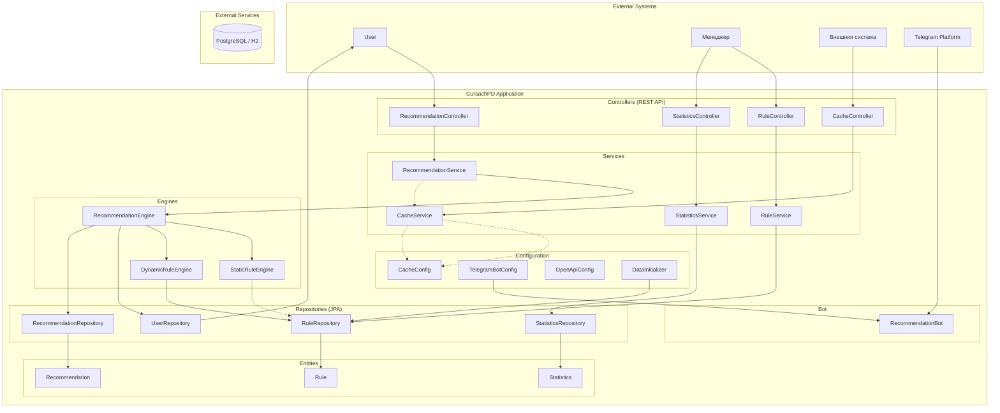
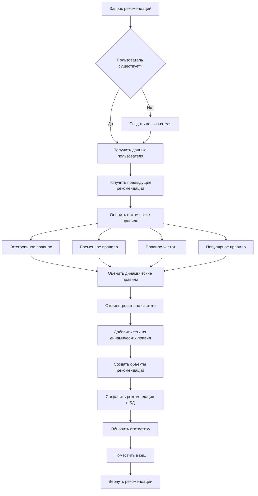
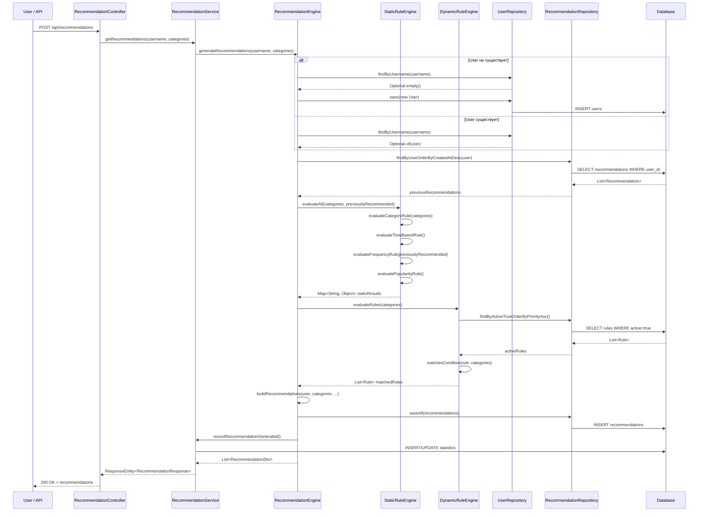
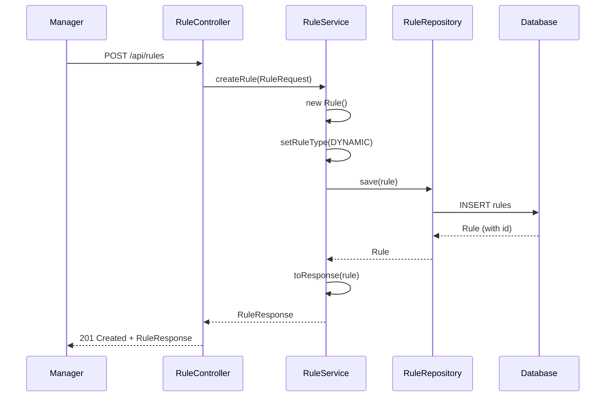
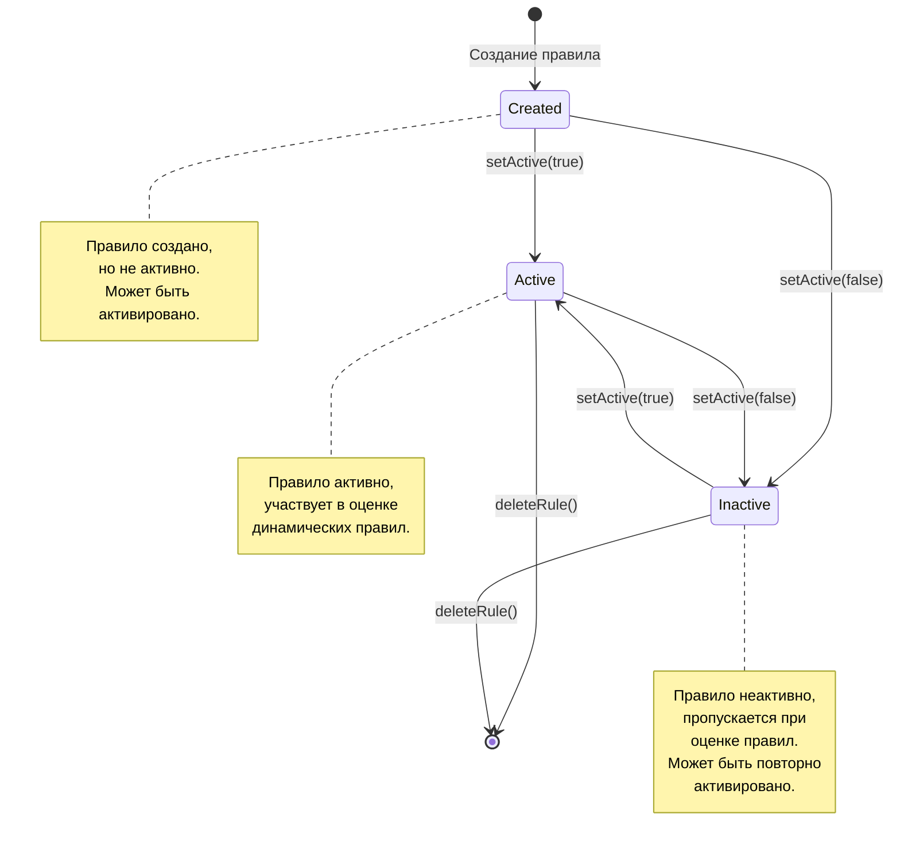

# Архитектура приложения

## Обзор

Приложение построено по слоистой архитектуре (Layered Architecture) с разделением на контроллеры, сервисы, репозитории и движки правил.

## Диаграмма компонентов (Component Diagram)

## Диаграмма деятельности (Activity Diagram) — Генерация рекомендаций

## Описание компонентов

### Контроллеры (Controllers)

| Компонент | Пакет | Описание |
|-----------|-------|----------|
| RecommendationController | `controller` | REST-эндпоинт для получения рекомендаций (POST `/api/recommendations`) |
| RuleController | `controller` | CRUD-операции для динамических правил (POST/PUT/DELETE `/api/rules`) |
| StatisticsController | `controller` | Получение статистики приложения (GET `/api/statistics`) |
| CacheController | `controller` | Управление кешем для внешних систем (POST `/api/cache/clear`) |

### Сервисы (Services)

| Компонент | Пакет | Описание |
|-----------|-------|----------|
| RecommendationService | `service` | Сервис рекомендаций с паттерном cache-aside |
| RuleService | `service` | CRUD-операции для динамических правил |
| StatisticsService | `service` | Управление метриками и статистикой |
| CacheService | `service` | Операции с кешем (get/put/clear) |

### Движки (Engines)

| Компонент | Пакет | Описание |
|-----------|-------|----------|
| RecommendationEngine | `engine` | Оркестратор: объединяет статические и динамические правила |
| StaticRuleEngine | `engine` | Оценивает встроенные правила (категории, время, частота, популярность) |
| DynamicRuleEngine | `engine` | Оценивает правила из БД в порядке приоритета |

### Репозитории (Repositories)

| Компонент | Пакет | Описание |
|-----------|-------|----------|
| UserRepository | `repository` | Работа с сущностью User |
| RuleRepository | `repository` | Работа с сущностью Rule |
| RecommendationRepository | `repository` | Работа с сущностью Recommendation |
| StatisticsRepository | `repository` | Работа с сущностью Statistics |

### Конфигурация (Configuration)

| Компонент | Пакет | Описание |
|-----------|-------|----------|
| CacheConfig | `config` | Настройка CaffeineCacheManager (30 мин TTL, 1000 элементов) |
| TelegramBotConfig | `config` | Создание бина RecommendationBot |
| OpenApiConfig | `config` | Настройка SpringDoc OpenAPI |
| DataInitializer | `config` | Инициализация начальных правил при старте |

### Telegram Bot

| Компонент | Пакет | Описание |
|-----------|-------|----------|
| RecommendationBot | `bot` | Telegram-бот для получения рекомендаций |

---

## UML Диаграммы

### 1. Диаграмма классов (Class Diagram)

Показывает все сущности, DTO, сервисы, контроллеры и их взаимосвязи.

```mermaid
classDiagram
    %% Entities
    class User {
        +Long id
        +String username
        +Long telegramChatId
        +String preferredCategories
        +LocalDateTime createdAt
        +getUsername()
        +setUsername()
        +getTelegramChatId()
        +setTelegramChatId()
    }

    class Rule {
        +Long id
        +String name
        +String condition
        +String action
        +Integer priority
        +boolean active
        +RuleType ruleType
        +LocalDateTime createdAt
        +LocalDateTime updatedAt
        +getName()
        +setName()
        +getCondition()
        +setCondition()
    }

    class Recommendation {
        +Long id
        +User user
        +String title
        +String description
        +String category
        +String source
        +String matchedRules
        +LocalDateTime createdAt
        +getTitle()
        +setTitle()
        +getCategory()
        +setCategory()
    }

    class Statistics {
        +Long id
        +String metricName
        +Long metricValue
        +String period
        +LocalDateTime recordedAt
        +getMetricName()
        +setMetricName()
        +getMetricValue()
        +setMetricValue()
    }

    %% DTOs
    class RecommendationRequest {
        +String username
        +List~String~ categories
        +getUsername()
        +setUsername()
        +getCategories()
        +setCategories()
    }

    class RecommendationResponse {
        +List~RecommendationDto~ recommendations
        +List~String~ matchedRules
        +getRecommendations()
        +setRecommendations()
        +getMatchedRules()
        +setMatchedRules()
    }

    class RecommendationDto {
        +String title
        +String description
        +String category
        +String source
        +getTitle()
        +setTitle()
        +getDescription()
        +setDescription()
    }

    class RuleRequest {
        +String name
        +String condition
        +String action
        +Integer priority
        +boolean active
        +getName()
        +setName()
        +getCondition()
        +setCondition()
    }

    class RuleResponse {
        +Long id
        +String name
        +String condition
        +String action
        +Integer priority
        +boolean active
        +String ruleType
        +LocalDateTime createdAt
        +LocalDateTime updatedAt
        +getName()
        +setName()
        +getRuleType()
        +setRuleType()
    }

    class StatisticsResponse {
        +long totalRecommendations
        +long activeRules
        +long totalUsers
        +Map~String,Long~ recommendationsByCategory
        +getTotalRecommendations()
        +setTotalRecommendations()
        +getActiveRules()
        +setActiveRules()
    }

    %% Controllers
    class RecommendationController {
        +RecommendationService recommendationService
        +getRecommendations(RecommendationRequest) ResponseEntity~RecommendationResponse~
    }

    class RuleController {
        +RuleService ruleService
        +createRule(RuleRequest) ResponseEntity~RuleResponse~
        +updateRule(Long, RuleRequest) ResponseEntity~RuleResponse~
        +deleteRule(Long) ResponseEntity~Void~
        +getAllRules() ResponseEntity~List~RuleResponse~~
        +getActiveRules() ResponseEntity~List~RuleResponse~~
    }

    class StatisticsController {
        +StatisticsService statisticsService
        +getStatistics() ResponseEntity~StatisticsResponse~
    }

    class CacheController {
        +CacheService cacheService
        +StatisticsService statisticsService
        +clearCache() ResponseEntity~Void~
        +getAppInfo() ResponseEntity~Map~String,Object~~
    }

    %% Services
    class RecommendationService {
        +RecommendationEngine recommendationEngine
        +CacheManager cacheManager
        +getRecommendations(String, List~String~) List~RecommendationDto~
        +clearUserCache(String)
    }

    class RuleService {
        +RuleRepository ruleRepository
        +createRule(RuleRequest) RuleResponse
        +updateRule(Long, RuleRequest) RuleResponse
        +deleteRule(Long)
        +getAllRules() List~RuleResponse~
        +getActiveRules() List~RuleResponse~
    }

    class StatisticsService {
        +StatisticsRepository statisticsRepository
        +RecommendationRepository recommendationRepository
        +UserRepository userRepository
        +RuleRepository ruleRepository
        +recordRecommendationGenerated()
        +getStatistics() StatisticsResponse
    }

    class CacheService {
        +CacheManager cacheManager
        +get(String, Class~T~) T
        +put(String, T)
        +clearAll()
    }

    %% Engines
    class RecommendationEngine {
        +StaticRuleEngine staticRuleEngine
        +DynamicRuleEngine dynamicRuleEngine
        +UserRepository userRepository
        +RecommendationRepository recommendationRepository
        +StatisticsService statisticsService
        +generateRecommendations(String, List~String~) List~RecommendationDto~
        +buildRecommendations(...) List~Recommendation~
    }

    class StaticRuleEngine {
        +evaluateCategoryRule(List~String~) Map~String,Object~
        +evaluateTimeBasedRule() Map~String,Object~
        +evaluateFrequencyRule(List~String~) Map~String,Object~
        +evaluatePopularityRule() Map~String,Object~
        +evaluateAll(List~String~, List~String~) Map~String,Object~
    }

    class DynamicRuleEngine {
        +RuleRepository ruleRepository
        +evaluateRules(List~String~) List~Rule~
        +evaluateAllActiveRules(List~String~) List~Rule~
    }

    %% Repositories
    class UserRepository {
        +findByUsername(String) Optional~User~
        +findByTelegramChatId(Long) Optional~User~
    }

    class RuleRepository {
        +findByActiveTrueOrderByPriorityAsc() List~Rule~
        +findByRuleType(RuleType) List~Rule~
        +countByActiveTrue() long
    }

    class RecommendationRepository {
        +findByUserOrderByCreatedAtDesc(User) List~Recommendation~
        +countByUser(User) long
        +count() long
    }

    class StatisticsRepository {
        +findByMetricNameAndPeriod(String, String) Optional~Statistics~
    }

    %% Relationships
    User "1" --> "0..*" Recommendation : has
    Rule ..> Rule : RuleType enum
    RecommendationController --> RecommendationService : uses
    RuleController --> RuleService : uses
    StatisticsController --> StatisticsService : uses
    CacheController --> CacheService : uses
    CacheController --> StatisticsService : uses
    RecommendationService --> RecommendationEngine : uses
    RecommendationService --> CacheService : uses
    RuleService --> RuleRepository : uses
    StatisticsService --> StatisticsRepository : uses
    StatisticsService --> RecommendationRepository : uses
    StatisticsService --> UserRepository : uses
    StatisticsService --> RuleRepository : uses
    CacheService --> CacheManager : uses
    RecommendationEngine --> StaticRuleEngine : uses
    RecommendationEngine --> DynamicRuleEngine : uses
    RecommendationEngine --> UserRepository : uses
    RecommendationEngine --> RecommendationRepository : uses
    RecommendationEngine --> StatisticsService : uses
    StaticRuleEngine ..> Map : returns
    DynamicRuleEngine --> RuleRepository : uses
    DynamicRuleEngine ..> Rule : returns
    UserRepository ..> User : manages
    RuleRepository ..> Rule : manages
    RecommendationRepository ..> Recommendation : manages
    StatisticsRepository ..> Statistics : manages
    RecommendationController ..> RecommendationRequest : receives
    RecommendationController ..> RecommendationResponse : returns
    RecommendationService ..> RecommendationDto : returns
    RuleController ..> RuleRequest : receives
    RuleController ..> RuleResponse : returns
```

### 2. Диаграмма последовательности (Sequence Diagram) — Получение рекомендаций

### 3. Диаграмма последовательности (Sequence Diagram) — Создание правила

### 4. Диаграмма состояний (State Diagram) — Правило

### 5. Диаграмма пакетов (Package Diagram)

```mermaid
graph TB
    subgraph org.example.cursachpd
        subgraph bot["bot"]
            RecBot["RecommendationBot"]
        end

        subgraph config["config"]
            CacheCfg["CacheConfig"]
            BotCfg["TelegramBotConfig"]
            OpenApiCfg["OpenApiConfig"]
            DataInit["DataInitializer"]
        end

        subgraph controller["controller"]
            RecCtrl["RecommendationController"]
            RuleCtrl["RuleController"]
            StatsCtrl["StatisticsController"]
            CacheCtrl["CacheController"]
        end

        subgraph engine["engine"]
            RecEng["RecommendationEngine"]
            StaticEng["StaticRuleEngine"]
            DynEng["DynamicRuleEngine"]
        end

        subgraph model["model"]
            subgraph dto["dto"]
                RecReq["RecommendationRequest"]
                RecResp["RecommendationResponse"]
                RecDto["RecommendationDto"]
                RuleReq["RuleRequest"]
                RuleResp["RuleResponse"]
                StatsResp["StatisticsResponse"]
            end
            subgraph entity["entity"]
                User["User"]
                Rule["Rule"]
                Rec["Recommendation"]
                Stats["Statistics"]
            end
        end

        subgraph repository["repository"]
            UserRepo["UserRepository"]
            RuleRepo["RuleRepository"]
            RecRepo["RecommendationRepository"]
            StatsRepo["StatisticsRepository"]
        end

        subgraph service["service"]
            RecSvc["RecommendationService"]
            RuleSvc["RuleService"]
            StatsSvc["StatisticsService"]
            CacheSvc["CacheService"]
        end
    end

    controller --> service
    service --> engine
    engine --> repository
    repository --> entity
    controller --> dto
    service --> dto
    config --> bot
    config --> service
```

---

## Сводная таблица диаграмм

| Диаграмма | Тип | Описание |
|-----------|-----|----------|
| Диаграмма компонентов | Component | Архитектура приложения и взаимодействие модулей |
| Диаграмма деятельности | Activity | Алгоритм генерации рекомендаций |
| Диаграмма классов | Class | Все классы, поля, методы и связи |
| Sequence: Получение рекомендаций | Sequence | Поток данных при получении рекомендаций |
| Sequence: Создание правила | Sequence | Поток данных при создании правила |
| Диаграмма состояний | State | Жизненный цикл правила (Created → Active → Inactive) |
| Диаграмма пакетов | Package | Структура пакетов приложения |
